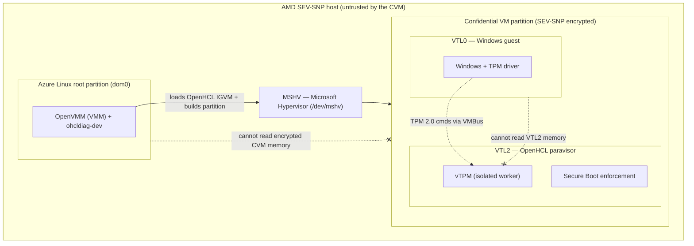

# How-to: Run a Windows CVM with a host-isolated vTPM using OpenHCL on Azure Linux + MSHV (AMD SEV-SNP)

**Audience:** Platform engineers (command-level detail).
**Goal:** Natively install Azure Linux with the Microsoft Hypervisor (MSHV) on an
AMD SEV-SNP host, use OpenVMM to create and monitor VMs, and launch a Windows
guest whose virtual TPM (vTPM) is protected from both the host and the
hypervisor by running it inside OpenHCL (VTL2).

This guide implements the design described in
[OpenHCL Architecture](https://openvmm.dev/guide/reference/architecture/openhcl.html).

---

## 0. How this stack protects the vTPM

Traditional virtualization emulates the vTPM in the host VMM. In that model the
host (and the hypervisor) can read vTPM state — unacceptable for a confidential
VM (CVM) where the host is untrusted.

OpenHCL moves the vTPM *inside* the guest's trust boundary:

- **OpenHCL is a paravisor** — "virtual firmware" that runs inside the guest
  partition at a higher privilege level than the guest OS.
- It uses **Virtual Trust Levels (VTLs)**:
  - **VTL2** — OpenHCL runs here. Hosts the emulated vTPM and enforces Secure
    Boot policy. Isolated from VTL0.
  - **VTL0** — the Windows guest OS. Cannot read VTL2 memory, so it cannot read
    the vTPM's secrets directly.
- On AMD **SEV-SNP** hardware the whole partition (VTL0 + VTL2) is memory-encrypted
  and integrity-protected, so the **host and hypervisor cannot read guest or
  paravisor memory**. The vTPM lives in encrypted VTL2 memory.
- For defense-in-depth, the vTPM can run in a **separate VTL2 worker process**
  (isolated-pool), so a compromise elsewhere in OpenHCL does not expose it.



> **Why MSHV and not KVM?** OpenHCL requires Hyper-V-style VTLs. The openvmm.dev
> note that "OpenHCL cannot be used on Linux hosts" refers specifically to **KVM**,
> which lacks the required VTL/VMPL primitives. **MSHV (the Microsoft Hypervisor)
> provides these**, so Azure Linux + MSHV is the correct Linux foundation for this
> scenario. This deployment uses no KVM.

---

## 1. Prerequisites

### Hardware
- AMD EPYC CPU with **SEV-SNP** support (3rd Gen "Milan" or newer).
- SEV-SNP enabled and provisioned in platform firmware (see §3).
- Sufficient RAM/cores; reserve headroom for VTL2 (OpenHCL needs its own slice of
  guest memory, typically a few hundred MB per CVM).
- A removable/virtual media path for the installer ISO (BMC/iDRAC/iLO virtual
  media, or a USB stick).

### Software / artifacts you will produce or download
- **Azure Linux installer ISO that already bundles MSHV** — produced by the ADO
  pipeline run
  [2610.3.1-ci.159380829](https://microsoft.visualstudio.com/LSG/_build/results?buildId=159380829&view=artifacts&pathAsName=false&type=publishedArtifacts).
  Booting and installing from this ISO installs the Microsoft Hypervisor and a
  dom0-capable kernel for you — no separate MSHV package install is required.
- **OpenVMM** binary (`openvmm`) — built on this host or downloaded from CI.
- **OpenHCL IGVM** image, CVM recipe (`openhcl-x64-cvm.bin`) — built on Linux/WSL2.
- **ohcldiag-dev** — diagnostics tool for OpenHCL.
- A **Windows guest image** (VHDX) prepared for Trusted Launch / CVM (UEFI +
  Secure Boot + TPM-aware).

### Host accounts / access
- Physical or BMC console access for the bare-metal install.
- Root on the installed host.

---

## 2. Stage 1 — Install Azure Linux (with MSHV) natively from the ISO

This stage uses the pipeline-produced ISO, which already includes MSHV and a
dom0 kernel. Installing from it gives you an Azure Linux root partition with the
Microsoft Hypervisor in place.

0. **Download the ISO** from the ADO build artifacts for run
   [2610.3.1-ci.159380829](https://microsoft.visualstudio.com/LSG/_build/results?buildId=159380829&view=artifacts&pathAsName=false&type=publishedArtifacts)
   (Artifacts tab → published artifacts → the `*.iso`). You must be signed in to
   the Microsoft ADO org to access it.

1. **Attach the ISO** via BMC virtual media (or write it to USB with
   `dd if=<downloaded>.iso of=/dev/sdX bs=4M status=progress && sync`).

2. **Boot the installer.** In firmware/BIOS set boot mode to **UEFI** (required
   for Secure Boot and for the CVM guest path), and boot the ISO.

3. **Run the installer.** Azure Linux ships a text/graphical installer
   (`mariner-installer`). Choose:
   - **Image type:** a full/CLI image (not the minimal container image).
   - **Disk layout:** standard GPT + EFI System Partition. Prefer a layout that
     leaves room for guest disk images (e.g. a dedicated `/var/lib/openvmm`
     filesystem or LVM volume).
   - **Hostname, user, SSH** as appropriate for a headless host.

4. **First boot & update:**
   ```bash
   sudo tdnf -y update
   sudo tdnf -y install vim git curl tar jq pciutils util-linux
   ```

5. **Confirm UEFI boot and firmware vars are present:**
   ```bash
   [ -d /sys/firmware/efi ] && echo "UEFI OK" || echo "NOT booted in UEFI mode"
   sudo tdnf -y install efibootmgr
   efibootmgr -v
   ```

> If you require a measured/attested host as well (host integrity, not just guest
> CVM isolation), enable host Secure Boot and TPM-based measured boot here. That
> is independent of the guest vTPM isolation this guide focuses on.

---

## 3. Stage 2 — Enable SEV-SNP and verify MSHV

The guest's vTPM protection ultimately rests on two things being active on the
host: **SEV-SNP** (memory encryption/integrity) and **MSHV** (the hypervisor that
provides VTLs). MSHV was already installed by the Stage 1 ISO, so here you enable
SEV-SNP in firmware/kernel and then confirm MSHV is live.

### 3a. Enable SEV-SNP in platform firmware
Reboot into BIOS/UEFI setup and enable (names vary by OEM):
- **SMEE** / Secure Memory Encryption.
- **SEV-SNP** support / "SNP Memory Coverage" (often set to *Enabled* or a
  specific RMP size).
- **SEV-ES ASID space** / minimum SEV ASID as required by your platform.
- **IOMMU** enabled.

Save and boot back into Azure Linux.

### 3b. Kernel command line for SEV-SNP (host side)
Ensure IOMMU and (if required by your kernel) the SNP host options are set. Edit
the bootloader config and append to the kernel cmdline:

```bash
# Azure Linux uses systemd-boot or GRUB depending on the image.
# For GRUB:
sudo vim /etc/default/grub
#   GRUB_CMDLINE_LINUX="... iommu=pt amd_iommu=on"
sudo grub2-mkconfig -o /boot/grub2/grub.cfg
```

Verify SEV/SNP after reboot:
```bash
sudo dmesg | grep -iE "SEV|SNP|ccp|RMP"
# Expect lines indicating SEV-SNP is enabled and the CCP/RMP initialized.
ls -l /dev/sev 2>/dev/null && echo "/dev/sev present"
```

### 3c. Confirm MSHV (the Microsoft Hypervisor) and dom0 kernel from the ISO
The Stage 1 ISO already installed the Microsoft Hypervisor and a dom0
(root-partition) kernel, so the Linux install acts as the **root partition** of
MSHV, analogous to the Hyper-V parent partition. The hypervisor is chain-loaded
before the Linux root partition; confirm the boot entry launches the hypervisor
loader and then the dom0 kernel. On systemd-boot, inspect the loader entries:

```bash
bootctl status
ls /boot/loader/entries/
cat /boot/loader/entries/*mshv*.conf 2>/dev/null
```

If the MSHV boot entry is not the default, set it so the host always boots the
hypervisor + dom0 kernel. (Only if the ISO did not pre-select it.)

### 3d. Verify MSHV is live and exposes VTL support
After rebooting into the MSHV + dom0 kernel:

```bash
# The MSHV user interface device must be present:
ls -l /dev/mshv && echo "MSHV root partition active"

# Confirm the running kernel is the dom0/mshv variant:
uname -r

# Confirm hypervisor presence and VSM/VTL capability in the logs:
sudo dmesg | grep -iE "microsoft hypervisor|hyperv|mshv|VSM|VTL"
```

You now have: an SEV-SNP host, running MSHV, with Azure Linux as the root
partition exposing `/dev/mshv`. This is the substrate OpenVMM targets.

> **Checkpoint.** Do not proceed until `/dev/mshv` exists **and** `dmesg` confirms
> SEV-SNP is initialized. The vTPM isolation guarantee is void without both.

---

## 4. Stage 3 — Install and configure OpenVMM

OpenVMM is the VMM that builds the VM partition, loads the OpenHCL IGVM into VTL2,
and monitors the guest. On Linux it supports the **MSHV** backend.

### Option A — Download a pre-built OpenVMM binary (fastest)
From the [OpenVMM CI](https://github.com/microsoft/openvmm/actions/workflows/openvmm-ci.yaml),
pick a green run and download the `*-openvmm` artifact for **x86_64 Linux**. Then:

```bash
sudo mkdir -p /opt/openvmm && cd /opt/openvmm
# unzip the downloaded artifact here
chmod +x ./openvmm
./openvmm --version
```

### Option B — Build OpenVMM on this host
```bash
# Rust toolchain
curl --proto '=https' --tlsv1.2 -sSf https://sh.rustup.rs | sh -s -- -y
source "$HOME/.cargo/env"

# Build deps on Azure Linux
sudo tdnf -y install git build-essential clang lld pkg-config openssl-devel \
                     protobuf-compiler

git clone https://github.com/microsoft/openvmm.git
cd openvmm
cargo xflowey restore-packages        # fetches UEFI (MSVM.fd), test kernels, etc.
cargo build --release -p openvmm
# Binary: ./target/release/openvmm
```

### Configure runtime assets
`cargo xflowey restore-packages` places the guest UEFI firmware used for the
Windows guest:

```
.packages/hyperv.uefi.mscoreuefi.x64.RELEASE/MsvmX64/RELEASE_VS2022/FV/MSVM.fd
```

Export it so you don't pass `firmware=` every time (needed when running the
`openvmm` binary directly rather than via `cargo run`):

```bash
export X86_64_OPENVMM_UEFI_FIRMWARE=$PWD/.packages/hyperv.uefi.mscoreuefi.x64.RELEASE/MsvmX64/RELEASE_VS2022/FV/MSVM.fd
```

Create a working directory for guest images and sockets:
```bash
sudo mkdir -p /var/lib/openvmm/{images,run}
```

> **Quitting OpenVMM:** COM1 is wired to your terminal, so `Ctrl-C` goes to the
> guest. Press **`Ctrl-Q`** to reach the interactive console, then **`q`** to quit.

---

## 5. Stage 4 — Obtain the OpenHCL IGVM (CVM recipe)

OpenHCL is delivered as an **IGVM** file: it tells the VMM how to load the
paravisor into VTL2, at which physical addresses, and carries the measurements
used for attestation. For a confidential (SEV-SNP) guest you need the **CVM**
recipe.

> **Build host note:** OpenHCL **can only be built on Linux/WSL2** — which is
> exactly what we have. You can build it directly on this Azure Linux host.

### Option A — Download a pre-built IGVM
From [OpenVMM CI](https://github.com/microsoft/openvmm/actions/workflows/openvmm-ci.yaml),
download the appropriate `*-openhcl-igvm` artifact (x64 CVM).

### Option B — Build the CVM IGVM locally
```bash
cd openvmm   # the repo cloned in Stage 3
# First build pulls many deps; --install-missing-deps lets xflowey install them.
cargo xflowey build-igvm x64-cvm --release --install-missing-deps

# Output:
#   flowey-out/artifacts/build-igvm/release/x64-cvm/openhcl-x64-cvm.bin
cp flowey-out/artifacts/build-igvm/release/x64-cvm/openhcl-x64-cvm.bin \
   /var/lib/openvmm/openhcl-x64-cvm.bin
```

Build **ohcldiag-dev** for diagnostics (it talks to OpenHCL over a VTL2 vsock):
```bash
cargo build --release -p ohcldiag-dev
# ./target/release/ohcldiag-dev
```

> **Measurement & attestation note:** The IGVM encodes the launch measurement of
> VTL2. In production you pin/verify this measurement (and, where used, a CoRIM
> endorsement via `igvmfilegen`) as part of guest attestation. Record the digest
> of the exact `openhcl-x64-cvm.bin` you deploy — it is part of your trust base.
> ```bash
> sha256sum /var/lib/openvmm/openhcl-x64-cvm.bin
> ```

---

## 6. Stage 5 — Launch the Windows guest with an OpenHCL-isolated vTPM

### 6a. Prepare the Windows guest disk
Place a UEFI + Secure Boot + TPM-aware Windows image as VHDX:
```bash
# Copy your prepared image in:
cp /path/to/windows.vhdx /var/lib/openvmm/images/windows.vhdx
# Dynamic/differencing VHD1 must be converted to VHDX first:
#   qemu-img convert -f vpc -O vhdx dynamic.vhd windows.vhdx
```

Use `memdiff:` while iterating (writes are discarded each run) and switch to
`file:` for persistent storage.

### 6b. Launch command (Windows in VTL0, OpenHCL + vTPM in VTL2)

The key points of this launch:
- `--hv --vtl2` + `--igvm firmware=openhcl-x64-cvm.bin,personality=openhcl`
  loads OpenHCL into VTL2.
- `--uefi` boots the Windows guest via the `mu_msvm` firmware, with Secure Boot.
- `--tpm` provides the vTPM; because OpenHCL is present and owns VTL2, the vTPM is
  serviced inside VTL2, isolated from VTL0 and the host.
- `--vmbus-redirect` lets OpenHCL act as the VMBus server and relay host devices
  to VTL0 (storage/net translation).
- `--vmbus-vtl2-vsock-path` exposes the diagnostics socket for `ohcldiag-dev`.

```bash
cd /opt/openvmm   # or the repo; adjust the openvmm path accordingly
IGVM=/var/lib/openvmm/openhcl-x64-cvm.bin
DISK=/var/lib/openvmm/images/windows.vhdx
DIAG=/var/lib/openvmm/run/ohcldiag-dev

./openvmm \
  --hv --vtl2 \
  --igvm "firmware=${IGVM},personality=openhcl" \
  --isolation snp \
  --uefi --secure-boot \
  --tpm \
  --vmbus-scsi id=scsi0,vtl2 \
  --openhcl-controller id=relay0,type=scsi \
  --disk "file:${DISK},on=scsi0,relay=relay0" \
  --vmbus-redirect \
  -m 8GB --processors 4 \
  --gfx \
  --com3 "term,name=VTL2 OpenHCL" \
  --vmbus-vtl2-vsock-path "${DIAG}"
```

Notes and tuning:
- `--isolation snp` requests the SEV-SNP isolated partition. On hardware without
  SNP active this will fail — that failure is the host doing its job. (Exact flag
  spelling can vary by OpenVMM version; run `./openvmm --help | grep -i isol` to
  confirm, and `--help | grep -i tpm` for the vTPM option.)
- `--gfx` enables the graphical console; see OpenVMM's Graphical Console docs for
  connecting a VNC viewer. Drop it for headless/serial-only installs.
- Memory: give the guest enough that VTL2 reservation still leaves your target
  VTL0 size. If VTL2 fails to initialize, raise `-m`.
- Storage/networking are shown using the VTL2-assigned + relay pattern so OpenHCL
  performs the storage translation; adjust `--disk`/`--net` to your environment.

### 6c. What to expect at boot
1. OpenVMM builds the SNP-isolated partition and loads OpenHCL into VTL2.
2. OpenHCL (VTL2) initializes, brings up the vTPM worker and Secure Boot policy,
   then starts VTL0.
3. The `mu_msvm` UEFI firmware runs in VTL0, measures boot into the vTPM, and
   boots Windows.
4. Inside Windows, the TPM appears as a standard TPM 2.0 device — but its state
   lives in encrypted VTL2 memory, unreadable by VTL0, the host, or MSHV.

---

## 7. Stage 6 — Verify the vTPM is present and isolated

### 7a. Confirm OpenHCL is running in VTL2 (from the host root partition)
```bash
# Kernel log from VTL2/OpenHCL:
./ohcldiag-dev /var/lib/openvmm/run/ohcldiag-dev kmsg

# Inspect running OpenHCL processes (the vTPM should run in its own worker):
./ohcldiag-dev /var/lib/openvmm/run/ohcldiag-dev inspect
```
Look for the TPM worker/device and a healthy VTL2 boot with no attestation errors.

### 7b. Confirm the vTPM inside Windows (VTL0)
In the Windows guest:
```powershell
Get-Tpm
Get-PnpDevice -Class SecurityDevices
# TPM 2.0 should be Present, Ready, Owned; Secure Boot should be On:
Confirm-SecureBootUEFI
```

### 7c. Confirm the host/hypervisor cannot read guest memory (isolation holds)
On the host, verify the partition is SNP-isolated and that guest RAM is encrypted
(host tooling cannot meaningfully dump it):
```bash
sudo dmesg | grep -iE "SNP|SEV|RMP"      # SNP active
./ohcldiag-dev /var/lib/openvmm/run/ohcldiag-dev inspect | grep -i isolation
```
The negative test is structural: with `--isolation snp`, host-side memory of the
CVM is encrypted/integrity-protected by hardware and the vTPM state is in VTL2 —
there is no host API that returns plaintext vTPM secrets.

### 7d. Attest the platform + paravisor (the real proof)
The authoritative verification is a **remote attestation** of the SEV-SNP report,
which includes the launch measurement covering the OpenHCL IGVM you pinned in §5:
- Retrieve the SNP attestation report from the guest (via the guest's attestation
  agent / Microsoft Azure Attestation flow, or your own verifier).
- Check the report's measurement against the **known-good digest** of
  `openhcl-x64-cvm.bin` and your expected VTL0 firmware/config.
- Only release vTPM-dependent secrets (e.g. disk encryption keys) after the
  measurement matches.

Record the expected values in your deployment config:
```bash
sha256sum /var/lib/openvmm/openhcl-x64-cvm.bin   # pin this
```

---

## 8. Monitoring & day-2 operations

- **Live diagnostics:** `ohcldiag-dev <socket> kmsg` (stream VTL2 log),
  `inspect` (component/device tree), and the other subcommands (`./ohcldiag-dev --help`).
- **Serial consoles:** `--com3 "term,name=VTL2 OpenHCL"` gives VTL2 kernel output;
  wire VTL0 serial via `--vmbus-com1-serial` if you need guest serial.
- **Lifecycle:** manage each VM as an OpenVMM process; for fleets, script launches
  and supervise with systemd units (one unit per CVM) so MSHV/OpenVMM restarts are
  controlled.

---

## 9. Troubleshooting

| Symptom | Likely cause | Action |
| --- | --- | --- |
| `/dev/mshv` missing | Not booted into MSHV/dom0 kernel | Fix boot entry so the hypervisor loader runs before the dom0 kernel; `bootctl status`, `uname -r`. |
| `--isolation snp` fails to start | SNP not enabled in firmware/kernel | Re-check BIOS SEV-SNP/SMEE/IOMMU; `dmesg | grep -i snp`; confirm `/dev/sev`. |
| VTL2 won't initialize / OOM | Not enough memory for VTL2 reservation | Increase `-m`; verify you built the **x64-cvm** recipe, not plain `x64`. |
| `must provide uefi firmware` | Running `openvmm` binary without env var | Set `X86_64_OPENVMM_UEFI_FIRMWARE` or pass `--uefi firmware=/path/MSVM.fd`. |
| vTPM absent in Windows | vTPM flag/personality mismatch | Confirm `--tpm` and `personality=openhcl`; check `ohcldiag-dev inspect` for the TPM worker. |
| Can't type / stuck console | COM1 is wired to the guest | `Ctrl-Q` then `q` to reach OpenVMM's console / quit. |
| Build failed on missing dep | First IGVM build needs toolchains | Re-run with `cargo xflowey build-igvm x64-cvm --install-missing-deps`. |

OpenVMM/OpenHCL troubleshooting references:
[OpenVMM](https://openvmm.dev/guide/user_guide/openvmm/troubleshooting.html) ·
[OpenHCL](https://openvmm.dev/guide/user_guide/openhcl/troubleshooting.html).

> **Maturity caveat (verify against your versions).** OpenVMM's fully-isolated
> SEV-SNP path on MSHV is evolving; exact flag names (`--isolation`, `--tpm`,
> `--secure-boot`) and device wiring can change between releases. Always confirm
> with `./openvmm --help` and the CI artifact's docs for the build you deploy.
> The production reference for this exact scenario (Windows CVM + OpenHCL vTPM) is
> Azure/Hyper-V; this guide reproduces that architecture on native Azure Linux +
> MSHV + OpenVMM.

---

## 10. References

- OpenHCL Architecture — https://openvmm.dev/guide/reference/architecture/openhcl.html
- Virtual Trust Levels (VSM) — https://learn.microsoft.com/en-us/virtualization/hyper-v-on-windows/tlfs/vsm
- OpenHCL (user guide) — https://openvmm.dev/guide/user_guide/openhcl.html
- Running OpenHCL — https://openvmm.dev/guide/user_guide/openhcl/run.html
- Building OpenHCL — https://openvmm.dev/guide/dev_guide/getting_started/build_openhcl.html
- IGVM image — https://openvmm.dev/guide/reference/architecture/openhcl/igvm.html
- Running OpenVMM — https://openvmm.dev/guide/user_guide/openvmm/run.html
- OpenVMM (supported hosts incl. MSHV) — https://openvmm.dev/guide/user_guide/openvmm.html
- AMD SEV-SNP white paper — https://www.amd.com/content/dam/amd/en/documents/epyc-business-docs/white-papers/SEV-SNP-strengthening-vm-isolation-with-integrity-protection-and-more.pdf
- Azure Linux — https://github.com/microsoft/azurelinux
- IGVM specification — https://github.com/microsoft/igvm
